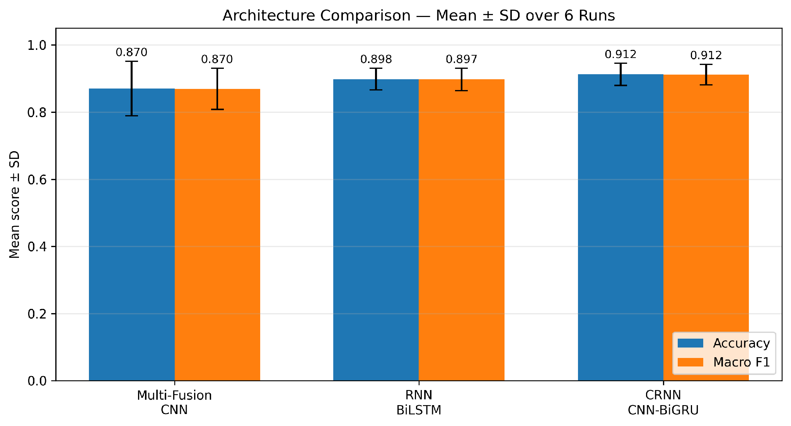
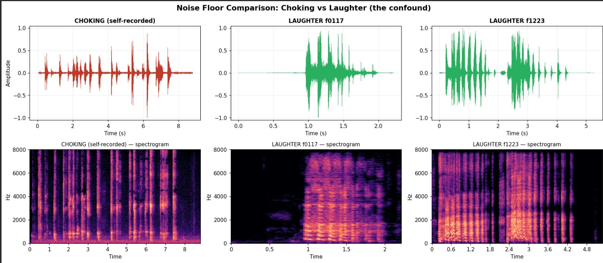
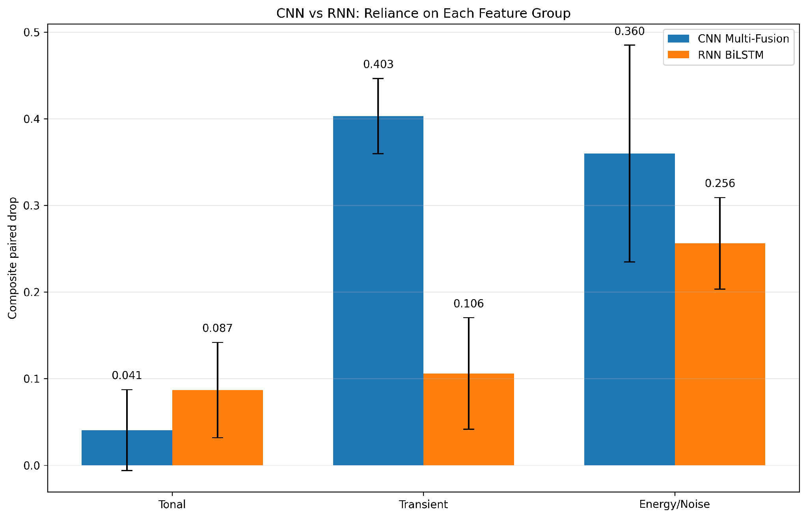
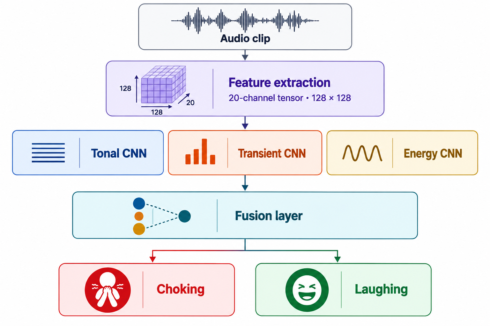
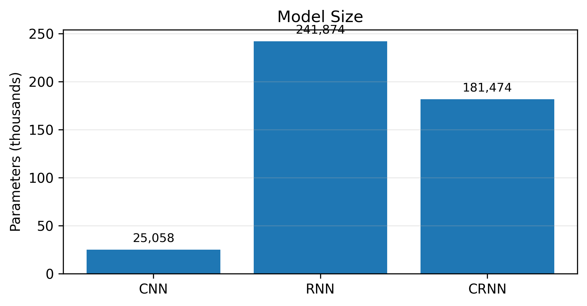
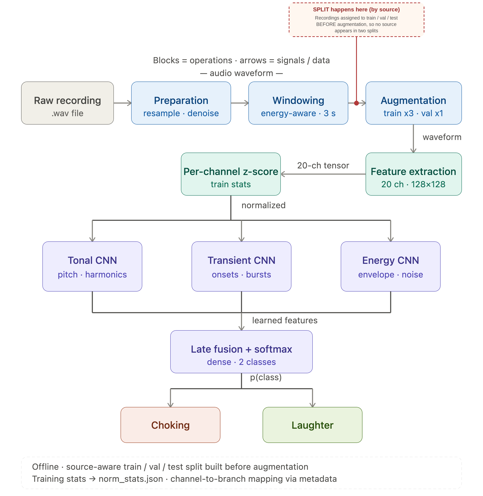

# Choking vs. Laughter Detection Using Audio Classification

This repository contains the code developed for a final-year electrical engineering project at Tel Aviv University, comparing deep learning architectures for automatic acoustic discrimination between **choking** and **laughter**, two acoustically similar, non-speech vocal events with opposite safety implications.

The project investigates whether machine-learning models can reliably distinguish these classes using a structured multi-feature audio representation, and whether different neural architectures rely on the same acoustic information to do so.

## Key results

| Stage | Architecture | Test accuracy |
|---|---|---|
| V1 | Fully-connected baseline | 58% |
| V2 | Flat CNN | 82% (biased toward choking) |
| V4 | Multi-branch CNN (Tonal / Transient / Energy) | 83%, balanced |
| V4 + prepared audio | Multi-branch CNN, robustness test on 2× test set | 81% |
| V4 + 15 epochs | Multi-branch CNN, extended training | 86.4% (best single run) |
| V5 | BiLSTM | 88.4% ± 4.2% (mean over 6 seeded runs) |
| V6 | CRNN (multi-branch CNN + BiGRU) | **91.2% ± 3.3%** (best mean, 6 seeded runs) |

All multi-run results are reported as mean ± standard deviation across six seeded runs, not single-run snapshots.

<p align="center">
  
</p>

## Key contributions

### 1. Recording-source confound diagnosis

Early models showed a strong bias toward laughter (choking recall as low as 0.25) despite reasonable overall accuracy. Quantitative noise-floor analysis revealed an 18-29 dB gap between self-recorded choking clips and laughter clips from cleaner online sources. The model was partly learning to detect the recording microphone, not the sound itself.

<p align="center">
  
</p>

A dedicated raw-audio preparation stage and a source-level (not window-level) train/val/test split were built to remove this shortcut.

### 2. Preprocessing outweighed architecture

Fixing data leakage and replacing per-sample normalization with per-channel z-score statistics (computed on the training set only) raised accuracy from ~57% to ~83% with no change to the network. This was the single largest improvement in the project.

### 3. Feature importance is architecture-dependent

A masking-based ablation study (six seeded runs, each feature group replaced by its training-set mean) found that the multi-branch CNN relies most heavily on **Transient** features to recognize laughter, while the BiLSTM relies most heavily on **Energy/Noise** features to recognize choking. The same acoustic information plays a different role depending on how the network consumes it. This is the project's central research finding.

<p align="center">
  
</p>

## Model architecture

The multi-branch CNN splits the 20-channel input tensor into three feature-family branches (Tonal, Transient, Energy), each processed by its own convolutional path before late fusion into a shared classifier:

<p align="center">
  
</p>

The CRNN (V6) extends this design by feeding the fused branch representations into a bidirectional GRU, adding explicit temporal modelling on top of the convolutional feature extraction. It reaches the highest mean accuracy of all architectures tested while using roughly 25% fewer parameters than the standalone BiLSTM:

<p align="center">
  
</p>

## Project pipeline

The code is organized around the following workflow:

1. **Raw-audio preparation**
   - resampling and cleanup
   - noise-floor handling
   - event-aware windowing
   - silence/content screening
   - normalization
2. **Audio preprocessing and feature extraction**
   - source-level train/validation/test splitting
   - raw-signal augmentation
   - pre-emphasis
   - extraction of a 20-channel feature representation
   - train-set normalization statistics
3. **Model training and evaluation**
   - Feed-Forward Neural Network (FNN)
   - Flat Convolutional Neural Network (CNN)
   - Multi-Fusion CNN
   - Recurrent Neural Network (BiLSTM/RNN)
   - Convolutional Recurrent Neural Network (CRNN)
4. **Robustness and feature analysis**
   - six-run architecture comparison
   - RNN feature-group importance analysis
   - Multi-Fusion CNN branch-importance analysis

The diagram below shows how a raw recording flows through the pipeline:

<p align="center">
  
</p>

## Repository structure

```text
choking-vs-laughter-detection/
├── README.md
├── requirements.txt
├── .gitignore
├── architecture_diagram.png
├── pipeline_block_diagram.png
├── recording_source_confound.png
├── architecture_comparison.png
├── feature_importance_by_architecture.png
├── model_size_comparison.png
│
├── processing/
│   ├── prepare_raw.py
│   └── audio_preprocessing_v3.py
│
├── notebooks/
│   ├── fnn.ipynb
│   ├── flat_cnn.ipynb
│   ├── multi_fusion_cnn.ipynb
│   ├── rnn.ipynb
│   └── crnn.ipynb
│
└── experiments/
    ├── rnn_feature_importance.ipynb
    ├── multi_fusion_cnn_feature_importance.ipynb
    └── architecture_comparison_6_runs.ipynb
```

> Confirm the notebook filenames above match what's actually committed before publishing. Some working copies used different version suffixes during development.

## Audio representation

The preprocessing pipeline extracts a 20-channel representation organized into three feature families, each feeding a dedicated branch of the multi-fusion CNN:

**Tonal**: pitch, voicing, harmonic structure
- Log-Mel spectrogram, Harmonic Mel spectrogram, Chroma, Tonnetz, MFCC, Spectral contrast

**Transient**: onsets, bursts, rapid spectral change
- Percussive Mel spectrogram, Delta, Delta-Delta, Spectral flux, Wide-band Mel spectrogram

**Energy / Noise**: energy envelope, spectral noisiness, turbulence
- RMS energy, RMS × periodicity, Zero-Crossing Rate (ZCR), Spectral flatness, Spectral centroid, Spectral rolloff, Spectral bandwidth, Fundamental frequency (F0), Voiced probability

## Data preparation

The raw preparation stage expects audio under:

```text
data/raw/choking/
data/raw/laughter/
```

Running `processing/prepare_raw.py` creates fixed-length prepared windows under `data/raw_prepared/` and records preparation metadata.

The feature-extraction stage then processes the prepared audio into train, validation, and test tensors. **Source recordings are grouped before splitting**, so that windows originating from the same recording remain in the same split. This is what prevents data leakage between train and test.

The generated audio, tensors, metadata, checkpoints, and other large experiment artifacts are intentionally excluded from this repository.

## Running the notebooks

The training notebooks were developed in **Google Colab** and retain their original experiment outputs, including logs, plots, and evaluation results.

Several notebooks contain a `PROJECT_DIR` pointing to the original Google Drive project directory. Change that variable to match your own Drive or local project location before running the notebooks.

Some notebooks correspond to different stages of the project and therefore preserve their experiment-specific processed-data paths and settings.

## Installation

For the Python preprocessing scripts, install the dependencies with:

```bash
pip install -r requirements.txt
```

PyTorch training is generally easiest to run in Google Colab with a GPU runtime.

## Dataset

The audio dataset is **not included** in this repository. Raw recordings, prepared audio, processed NumPy tensors, and trained model checkpoints are excluded to keep the repository lightweight and to avoid distributing project data unintentionally.

## Project context

Final-year project (24-1-1-3295), Iby and Aladar Fleischman Faculty of Engineering, School of Electrical Engineering, Tel Aviv University.

## Authors

- Leticia Kaplan
- Eytan Lev

**Advisor:** Dr. Lior Arbel
